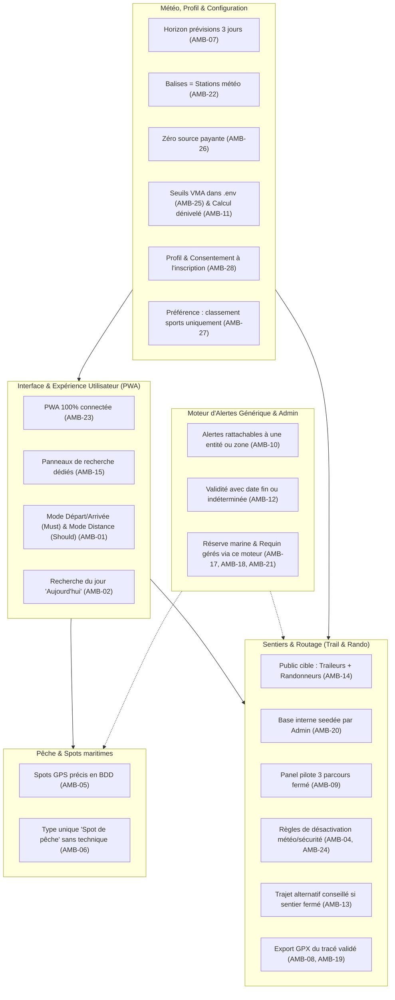

# Tableau de Résolution des Ambiguïtés du Cahier des Charges (§11.2)

**Auteur :** Thomas (TiBenoit)  
**Date :** 23/11/2026  
**Projet :** MeteoSport  
**Documents de référence :**
* Cahier des charges : [cahier-des-charges-v1.md](file:///home/thomaz/Documents/project/Expernet/MeteoSport/tdd/docs/cdc/cahier-des-charges-v1.md) (§11.2 Ambiguïtés `AMB-01` à `AMB-28`)
* Compte rendu d'entretien : [cr-001.md](file:///home/thomaz/Documents/project/Expernet/MeteoSport/tdd/docs/cr/cr-001.md)
* Statut global : **100 % des ambiguïtés résolues et tranchées**

---

## 1. Contexte et Principes Directeurs d'Arbitrage

La section 11.2 du Cahier des charges v1 recensait **28 ambiguïtés** (`AMB-01` à `AMB-28`) en attente de clarification client ou d'arbitrage de conception. Ce document consigne formellement les réponses apportées par Thomas (TiBenoit), les décisions d'architecture validées et leurs impacts directs sur le CDC et l'implémentation du MVP.

### Principes directeurs issus de ces arbitrages :
1. **Faisabilité stricte sous 3 semaines (MVP 09/12/2026 - 14/12/2026) :**
   * **Zéro coût récurrent :** aucune source ni API payante autorisée (`AMB-26`).
   * **PWA connectée obligatoire :** aucun mode hors-ligne lourd/complexe à développer ; connexion active requise (`AMB-23`). Le relais terrain hors-ligne repose sur l'export du fichier `.gpx` (`AMB-19`) lisible sur montre ou GPS autonome.
2. **Architecture de données maîtrisée & Données fermées :**
   * Les sentiers officiels balisés sont seedés en interne par l'administrateur (`AMB-20`). L'application n'a pas de dépendance critique à une API cartographique temps-réel instable.
   * Les spots de pêche sont stockés avec des coordonnées GPS précises pour calcul de distance spatiale (`AMB-05`), sans distinction inutile des techniques de pêche (`AMB-06`).
   * Le panel pilote reste strictement borné aux 3 parcours convenus (`AMB-09`).
3. **Moteur d'alertes générique et administrable :**
   * Au lieu de coder en dur des alertes rigides (Réserve marine, Risque requin, etc.), un système générique permet à l'administrateur d'associer une ou plusieurs alertes (temporaires ou indéterminées) à un sentier, un spot ou une zone (`AMB-10`, `AMB-12`, `AMB-17`, `AMB-18`, `AMB-21`).
4. **Logique de routage et de sécurité des sentiers :**
   * Modèle par défaut « sentier disponible ». Application de **règles de désactivation** (terrain dégradé sous forte pluie, fermeture administrative). Le trajet conseillé exclut les sentiers désactivés, tandis que le trajet choisi par l'utilisateur les signale avec alerte explicite (`AMB-04`, `AMB-13`, `AMB-24`).
5. **Ciblage utilisateur & RGPD :**
   * Les **randonneurs font partie intégrante du public visé** au même titre que les traileurs (`AMB-14`).
   * Pas de profil utilisateur sans inscription ; consentement et recueil du profil (VMA, gabarit) dès l'inscription (`AMB-28`). Seuils de niveau de VMA paramétrables dans le fichier d'environnement `.env` (`AMB-25`).

---

## 2. Tableau Général de Réponse aux Ambiguïtés (§11.2)

| # | Constat / Question du CDC v1 | Source CDC / CR | Réponse apportée | Décision & Impact Fonctionnel / Technique | Statut |
|---|---|---|---|---|:---:|
| **AMB-01** | « Une suggestion de trace d'environ 40/50 km » et « une trace sur mesure par rapport aux tracés de rando connus » décrivent une recherche **par distance**. Le parcours utilisateur, lui, demande **un départ et une arrivée**. S'agit-il de deux modes de recherche ? | `CR-001/§1` | *« Oui il y a deux modes de recherche, il y a le mode de recherche par Distance et par départ/arrivée »* | **Deux modes confirmés :** 1. Recherche par couple **Départ / Arrivée** (mode prioritaire, Must, `REQ-001`). 2. Recherche / suggestion **par Distance** cible (Should, `REQ-010`). L'UI prévoit un sélecteur de mode. | ✅ Tranché |
| **AMB-02** | À « Que voulez-vous faire aujourd'hui ? », est-ce l'utilisateur qui choisit l'activité ou l'application qui la recommande ? « Aujourd'hui » limite-t-il la recherche au jour même, alors que les prévisions portent sur les prochains jours ? | `CR-001/§1, Q11, Q13` | *« Limite la recherche à aujourd'hui »* | **Recherche immédiate à J :** La suggestion active et la recommandation d'activité directe sont strictement bornées à la journée en cours (« Aujourd'hui »). La consultation des prévisions météo sur les jours suivants (`AMB-07`) reste accessible pour consultation / préparation. | ✅ Tranché |
| **AMB-03** | « Difficulté » : cotation officielle du sentier, ou difficulté ressentie selon le niveau de l'utilisateur (« itinéraires selon le niveau ») ? | `CR-001/§1` | *« Cotation officielle, selon ce qui est défini par l'admin »* | **Difficulté objective officielle :** La difficulté affichée correspond à la cotation officielle configurée en base par l'administrateur (`difficulty_level`). L'impact du profil utilisateur s'applique uniquement sur le temps de parcours estimé (`REQ-005`). | ✅ Tranché |
| **AMB-04** | Le trajet conseillé est-il toujours affiché, ou seulement quand une règle est déclenchée ? Peut-il proposer « un autre secteur » (question Q16) que celui choisi ? | `CR-001/Q16, Q34` | *« Le trajet conseillé est le trajet selon ce que l'user choisit de voir selon les filtres (facile, difficile,...), oui on peut proposer un autre secteur si disponible. Attention les règles imposées sur les sentiers seront généralement des règles de désactivation : par défaut un sentier sera disponible, si des règles (dégradé en cas de pluie, fermé...) sont actives il ne sera pas proposé en sentier conseillé mais sera toujours proposé avec alerte »* | **Règles de désactivation & Déclenchement :** 1. Le trajet conseillé tient compte des filtres utilisateur et peut explorer un autre secteur si disponible. 2. Les règles de sécurité fonctionnent par **désactivation** : un sentier est actif par défaut. Si une règle se déclenche (pluie forte, fermeture), le sentier est exclu du trajet conseillé. 3. Le trajet choisi par l'utilisateur conserve les sentiers sélectionnés mais affiche une alerte visible (`REQ-004`, `REQ-008`). | ✅ Tranché |
| **AMB-05** | « Meilleure côte » : de quelle échelle parle-t-on ? Une façade de l'île, une commune (« Saint-Paul », Q12) ou un spot précis ? | `CR-001/§1, Q09, Q12` | *« Selon les spots disponibles dans la zone définie. Les spots seront enregistrés avec un point GPS précis pour des calculs de distance depuis la base de données »* | **Spots géolocalisés précis :** Les spots de pêche sont enregistrés en base avec leurs coordonnées GPS précises (latitude/longitude). Le calcul de recommandation s'appuie sur la distance géographique depuis le point de départ de l'utilisateur (`REQ-009`, `REQ-026`). | ✅ Tranché |
| **AMB-06** | La question Q08 cite le surfcasting et le lancer comme formes de pêche du bord. Toutes les formes de pêche du bord sont-elles concernées ? | `CR-001/Q08` | *« Pas de précision pour nous ici, on donnera spot de pêche sans précision du type de pêche »* | **Catégorie unique « Spot de pêche » :** Aucune segmentation complexe par sous-technique de pêche (lancer, surfcasting, etc.). L'application gère de façon uniforme l'entité `Spot de pêche du bord`, simplifiant les modèles de données et l'IHM. | ✅ Tranché |
| **AMB-07** | « Prochains jours » : combien de jours de prévision ? | `CR-001/Q13` | *« 3 jours de prévision »* | **Horizon fixé à J+3 :** La météo horaire et journalière couvre la journée courante et les deux jours suivants (72 heures). Cadrage ferme pour les requêtes vers l'API météo et le cache interne. | ✅ Tranché |
| **AMB-08** | Quel tracé est exporté en `.gpx` : celui choisi par l'utilisateur ou le trajet conseillé ? Qui « valide » l'itinéraire ? | `CR-001/Q19` | *« Celui choisi par l'user »* | **Tracé retenu par l'utilisateur :** L'export `.gpx` (`REQ-011`) génère le fichier du tracé final sélectionné et validé par l'utilisateur (tracé initial ou alternative conseillée retenue). | ✅ Tranché |
| **AMB-09** | Le panel pilote est cité avec « notamment » : la liste est-elle fermée ? | `CR-001/Q40` | *« Okay on garde cela »* | **Liste fermée validée :** Le panel pilote pour la démonstration et les tests est strictement restreint aux 3 parcours définis : 1. La Possession → Mafate 2. Roche Écrite 3. Piton des Neiges. | ✅ Tranché |
| **AMB-10** | Les « alertes » gérées par l'administrateur sont-elles des alertes sur les sentiers, la météo ou le littoral ? | `CR-001/Q42` | *« L'administrateur pourra définir des alertes sur chaque type de zone définie (sentier, zone de pêche), le but étant que sur la page de ces éléments on y voit l'alerte si déclarée »* | **Alertes ciblées par entité :** L'administrateur peut rattacher un message d'alerte à un sentier ou à une zone/spot de pêche. L'alerte est affichée contextuellement sur la vue détaillée de l'élément concerné (`REQ-022`). | ✅ Tranché |
| **AMB-11** | Le CR parle de l'heure de passage (Q15) sans dire comment elle tient compte du dénivelé et du terrain. Une estimation à partir de la seule VMA est peu fiable en montagne. | `CR-001/Q15, Q21` | *« Estimation VMA et règle dénivelé »* | **Calcul d'allure pondéré :** L'algorithme calcule le temps de passage par tronçon en appliquant une formule fixe combinant la vitesse de base (VMA utilisateur) et l'impact de la pente / dénivelé (ex: ratio D+/D- standard trail/montagne). | ✅ Tranché |
| **AMB-12** | Quand l'administrateur force l'état d'un sentier, ce forçage dure-t-il jusqu'à ce qu'il le retire, ou jusqu'à la prochaine information automatique ? | `CR-001/Q36` | *« Il pourra définir une durée ou indéterminé (jusqu'à désactivation) »* | **Double mode d'expiration :** Lors de la saisie d'un forçage ou d'une alerte, l'administrateur spécifie soit une date/heure d'expiration (`expires_at`), soit une validité indéterminée qui reste active jusqu'à désactivation manuelle (`REQ-021`). | ✅ Tranché |
| **AMB-13** | « Trajet choisi par l'utilisateur » (§1) : qui le produit ? L'application à partir du départ et de l'arrivée, ou l'utilisateur en choisissant ses sentiers ? Peut-il passer par un sentier fermé, alors que Q34 cite un sentier fermé comme déclencheur du trajet conseillé ? Q16 ne limite que le trajet **conseillé** aux sentiers balisés. | `CR-001/§1, Q16, Q18, Q34` | *« L'application propose un trajet choisi sur sentiers officiels balisés, que l'utilisateur peut ajuster. Un sentier fermé y est signalé (REQ-004) et déclenche le trajet conseillé (REQ-008) »* | **Proposition assistée + Ajustement :** L'application génère l'itinéraire de base sur les sentiers balisés du réseau. L'utilisateur peut l'ajuster. Tout sentier fermé reste affiché sur le trajet choisi avec une alerte rouge (`REQ-004`) et provoque l'affichage automatique d'un trajet de contournement conseillé (`REQ-008`). | ✅ Tranché |
| **AMB-14** | Le client parle de « tracés de rando connus » (§1), mais limite le périmètre au trail et à la pêche (Q05). Les randonneurs font-ils partie du public visé ? | `CR-001/§1, Q05` | *« Le trail et les randonneurs sont le même public »* | **Extension de cible validée :** Traileurs et randonneurs font partie du **même public cible**. Ils partagent le même réseau de sentiers et les mêmes besoins d'arbitrage météo. Le CDC doit intégrer formellement les randonneurs dans les personas et les règles d'allure de marche. | ✅ Tranché |
| **AMB-15** | Q12 prévoit la saisie du temps disponible « pour affiner la recommandation », dans le volet pêche. Vaut-elle aussi pour une sortie trail ? | `CR-001/Q12` | *« Pour la pêche et le trail les panneaux de saisie doivent être adaptés selon les activités »* | **IHM dédiée par discipline :** Panneaux et formulaires de saisie contextualisés pour chaque sport. Pêche : créneau disponible, secteur/côte. Trail/Randonnée : point de départ, point d'arrivée, dénivelé accepté, mode boucle/aller simple. | ✅ Tranché |
| **AMB-16** | « Conditions équivalentes » (Q33) : à partir de quel écart deux scores sont-ils considérés comme équivalents ? | `CR-001/Q33` | *« Seuil paramétrable »* | **Seuil d'équivalence en configuration :** La tolérance d'écart entre scores pour considérer deux activités comme équivalentes est une constante configurable dans l'application (`SCORE_TOLERANCE_THRESHOLD`), sans logique codée en dur. | ✅ Tranché |
| **AMB-17** | Q32 prévoit l'alerte Réserve marine « pour toute activité sur la côte ouest ». Concerne-t-elle seulement la pêche et la chasse sous-marine, ou aussi un parcours trail sur le littoral ouest ? | `CR-001/Q32` | *« Seulement pour la pêche, mais on ne va pas déclarer une alerte spécifique pour cela, le but étant que pour un type d'activité on ait la possibilité de définir un ou plusieurs types d'alerte temporaire ou indéterminée »* | **Alerte générique pour la pêche :** L'alerte Réserve marine ne concerne que la pêche. Elle ne fait pas l'objet d'un code métier ad hoc : elle est administrée via le système générique d'alertes par zone/activité avec durée indéterminée. | ✅ Tranché |
| **AMB-18** | L'alerte requin vise-t-elle aussi certaines formes de pêche du bord exposées (pieds dans l'eau, platier) ? Q10 ne limite pas le requin à une pratique. | `CR-001/Q10` | *« Même réponse que précédent »* | **Alerte requin via moteur générique :** Même règle qu'`AMB-17`. L'alerte requin est créée comme une alerte administrative paramétrable sur les spots ou secteurs maritimes pertinents, évitant les règles rigides dans le code applicatif. | ✅ Tranché |
| **AMB-19** | Q06 : le client répond « le trail, avec le tracé GPX », alors que la question opposait « le GPX sur mesure » aux autres options. Cela peut désigner l'**export** d'un fichier `.gpx` ou la **trace sur mesure** (suggestion par distance, REQ-010). | `CR-001/§1, Q06, Q19` | *« L'export du fichier GPX »* | **Export standardisé GPX :** « Tracé GPX » qualifie l'exportation du fichier `.gpx` standard (`REQ-011`, Must) exploitable sur montre de sport/GPS. La trace sur mesure par distance demeure un mode de recherche distinct (`AMB-01`, `REQ-010`, Should). | ✅ Tranché |
| **AMB-20** | « Sentier officiel balisé » n'est défini nulle part : quelle liste fait foi ? « Officiel » et « ouvert » sont-ils distincts ? La source libre du réseau (Q28) permet-elle de repérer le balisage ? | `CR-001/Q16, Q28` | *« Les sentiers seront importés par les admins via les seed, on référencera uniquement ces sentiers dans l'app, pour les mises à jour des données les services API devront faire la liaison avec nos sentiers en interne »* | **Graphe interne via Seeds & Mapping API :** L'application s'appuie sur une base de sentiers officiels fermée, injectée en base par script de seed. Les services externes (météo, arrêtés éventuels) font la correspondance via des identifiants/coordonnées internes. Pas de dépendance directe à une API tierce pour la topologie des sentiers. | ✅ Tranché |
| **AMB-21** | « Côte ouest » n'est pas délimitée : quelles communes déclenchent l'alerte Réserve marine ? | `CR-001/Q32` | *« Voir réponse alerte ci-dessus »* | **Pas de découpage géographique rigide en dur :** L'administrateur positionne les alertes directement sur les zones ou spots de pêche situés sur la côte Ouest (`AMB-10`, `AMB-17`). Aucun polygone géographique lourd à maintenir dans le code. | ✅ Tranché |
| **AMB-22** | « Balises » dans le découpage météo : s'agit-il de stations météo ou du balisage des sentiers ? | `CR-001/Q38` | *« Station météo »* | **Confirmation stations météo :** « Balises » désigne des stations de mesure météorologique géolocalisées servant de référence météo pour les zones découpées (`REQ-108`). | ✅ Tranché |
| **AMB-23** | Q27 : « pas de mode hors ligne **complexe** ». Un mode simple consultable sans réseau est-il souhaité ? Q01 parle d'une « possibilité de PWA », Q27 d'une « PWA retenue ». | `CR-001/Q01, Q27` | *« Non pas de mode hors ligne à déclarer, on part sur une app PWA qui nécessite le mode en ligne »* | **PWA 100 % connectée :** Pas de développement de mode hors-ligne. L'application exige une connexion Internet active pour fonctionner. En cas de coupure réseau, une alerte invite l'utilisateur à se reconnecter (`REQ-109`). L'usage terrain sans réseau est couvert par le fichier `.gpx`. | ✅ Tranché |
| **AMB-24** | §1 : « adapte l'itinéraire aux conditions météo réelles ». « Réelles » désigne-t-il des observations ou des prévisions ? « Adapter » veut-il dire seulement changer de tracé, ou aussi proposer un autre horaire de départ ? | `CR-001/§1, Q13, Q14` | *« Avec le calcul sur les règles définies »* | **Calcul basé sur les règles de sécurité :** L'adaptation d'itinéraire consiste à recalculer un tracé alternatif sur les sentiers balisés en excluant les tronçons dont les règles de sécurité sont violées (précipitations excessives, fermeture, etc.), sans proposer de décalage d'horaire (`REQ-008`). | ✅ Tranché |
| **AMB-25** | « Niveau » (§1 : « itinéraires selon le niveau », Q21) : comment se déduit-il du profil ? Comment l'âge, le poids et la taille entrent-ils dans les calculs ? | `CR-001/§1, Q21` | *« On estimera le niveau via la VMA seuil paramétrable dans l'env du projet »* | **Paliers VMA dans les variables d'environnement :** Le niveau utilisateur est déduit de la VMA renseignée. Les seuils de classification (ex : Débutant, Intermédiaire, Expert) sont définis dans le `.env` (`VMA_THRESHOLD_BEGINNER`, etc.), garantissant une adaptation facile sans redéploiement. | ✅ Tranché |
| **AMB-26** | Q28 parle d'un « **objectif** 0 € ». Une source payante indispensable serait-elle refusée ou rediscutée avec le client ? | `CR-001/Q28` | *« Pas de source payante »* | **Contrainte absolue 0 € :** Interdiction ferme d'intégrer toute source de données payante. Toute donnée sans API gratuite disponible (ex: certaines prévisions de houle ou marées) est gérée par défaut ou omise avec avertissement explicite à l'utilisateur. | ✅ Tranché |
| **AMB-27** | Q11 : « en tenant compte des préférences de l'utilisateur ». S'agit-il du seul classement des sports, ou d'autres éléments du profil ? | `CR-001/Q11` | *« Sport uniquement »* | **Arbitrage sur les sports favoris seuls :** Seul le classement hiérarchique des sports préférés (ordre de priorité déclaré par l'utilisateur) est utilisé pour départager les recommandations d'activités équivalentes (`R-12`). | ✅ Tranché |
| **AMB-28** | Q24 : consentement « à l'inscription ». Ce n'est pas équivalent à « avant toute saisie » (REQ-018) si le profil est rempli après l'inscription. | `CR-001/Q24` | *« Sans inscription l'user n'a pas de profil, son profil est enregistré à l'inscription »* | **Inscription et profil synchrones :** Aucun profil sans compte utilisateur. Le recueil des données physiologiques (VMA, poids, taille) et le recueil obligatoire du consentement RGPD sont intégrés au parcours unifié de création de compte (`REQ-016`, `REQ-018`). | ✅ Tranché |

---

## 3. Synthèse Détaillée par Domaine et Décisions Techniques

### 3.1. Trail, Randonnée & Gestion du Réseau de Sentiers
* **Inclusion des randonneurs (`AMB-14`) :** Le trail et la randonnée partagent la même infrastructure. Les formules de temps de parcours doivent prévoir une allure marche pour les randonneurs et une allure basée sur la VMA pour les traileurs (`AMB-11`).
* **Source interne des sentiers (`AMB-20`) :** Les sentiers sont initialisés via des seeds (données géographiques GeoJSON stockées en base locale). Cette architecture évite l'instabilité d'APIs externes et supprime le risque de dépassement de quota ou de coût.
* **Logique de sécurité négative (`AMB-04`, `AMB-24`) :** Tout sentier est réputé ouvert par défaut. Une règle de dégradation (pluie supérieure au seuil ou arrêté administratif) active une règle de désactivation :
  * Dans le calcul du **trajet conseillé** (`REQ-008`), les segments désactivés sont exclus de l'algorithme de graphe.
  * Dans le **trajet choisi par l'utilisateur** (`REQ-003`), les sentiers restent affichés mais marqués d'une alerte bloquante ou informative (`REQ-004`).

### 3.2. Pêche & Façades Côtières
* **Modélisation géographique (`AMB-05`) :** Les spots de pêche sont des entités ponctuelles géoréférencées (latitude, longitude, commune). Le moteur calcule la distance réelle avec le point de départ utilisateur.
* **Simplification du domaine (`AMB-06`) :** Aucune gestion différenciée des techniques de pêche (lancer, surfcasting...). L'affichage et la notation des conditions s'appliquent globalement au spot.

### 3.3. Architecture Générique des Alertes
* **Suppression du code ad hoc (`AMB-10`, `AMB-17`, `AMB-18`, `AMB-21`) :**
  L'application ne contiendra pas de règles hardcodées pour la « Réserve marine » ou le « Risque requin ».
  L'administrateur dispose d'une entité `Alert` :
  * `id`, `title`, `message`, `severity` (info, warning, danger)
  * `target_type` (`trail`, `fishing_spot`, `zone`)
  * `target_id` (identifiant de l'entité)
  * `expires_at` (date/heure ou NULL pour indéterminé, `AMB-12`)
  * `is_active` (booléen)
  Les alertes s'affichent dynamiquement sur les fiches des entités concernées.

### 3.4. Données, Météo & Coûts
* **Horizon météo (`AMB-07`) :** Limité à 3 jours (J à J+2). Les requêtes API gratuites sont réduites, facilitant la mise en cache horaire.
* **Stations météo (`AMB-22`) :** Les « balises » du CR désignent les stations météorologiques réelles utilisées pour mailler l'île.
* **Contrainte de budget (`AMB-26`) :** Zéro source payante. En l'absence d'API marine gratuite fiable pour la houle ou les marées sur certains spots, un avertissement transparent est affiché plutôt que de souscrire un abonnement payant.

### 3.5. Authentification, Profil et PWA
* **Profil utilisateur (`AMB-28`) :** La saisie de la VMA, du poids, de la taille et le consentement RGPD sont exigés dès la création de compte. Pas d'accès au profil sans inscription.
* **Paramétrage des niveaux (`AMB-25`) :** Les seuils de VMA (débutant, intermédiaire, confirmé) sont injectés via l'environnement (`.env`), facilitant l'ajustement sans recompilation.
* **PWA en ligne (`AMB-23`) :** L'application est une Progressive Web App connectée, sans base de données locale offline complexe. L'autonomie en montagne est assurée par l'export GPX (`AMB-08`, `AMB-19`).

---

## 4. Matrice de Mise à Jour pour le CDC (Passage en v1.2)

Ce tableau synthétise les modifications à reporter directement dans le [cahier-des-charges-v1.md](file:///home/thomaz/Documents/project/Expernet/MeteoSport/tdd/docs/cdc/cahier-des-charges-v1.md) :

| Élément CDC | Section | Situation actuelle (v1.1) | Modification cible (v1.2) | Ambiguïté source |
|---|---|---|---|:---:|
| **Tableau 11.2** | §11.2 | `AMB-01` à `AMB-28` avec statut « en attente » | Remplacer « en attente » par **« Tranché »** avec les décisions du présent document | `AMB-01` à `AMB-28` |
| **Personas / Cible** | §5 | Randonneurs exclus ou en attente d'arbitrage | Randonneurs intégrés comme public cible explicite aux côtés des traileurs | `AMB-14` |
| **Modes de recherche** | §6, §9 | Recherche par départ/arrivée seule en Must | Deux modes formalisés : Départ/Arrivée (Must, `REQ-001`) et Par distance (Should, `REQ-010`) | `AMB-01` |
| **Périmètre temporel** | §6, §9 | Horizon multi-jours ambigu | Recherche du jour bornée à « Aujourd'hui » ; consultation météo à 3 jours max | `AMB-02`, `AMB-07` |
| **Routage et sécurité** | §9 | Trajet conseillé formulé de façon générique | Formalisation des règles de **désactivation** et proposition d'un autre secteur si besoin | `AMB-04`, `AMB-13`, `AMB-24` |
| **Spots de pêche** | §9 | Secteurs côtiers à l'échelle de la commune | Spots géolocalisés précis par coordonnées GPS en BDD ; type unique « Spot de pêche » | `AMB-05`, `AMB-06` |
| **Système d'alertes** | §8, §9 | Règles spécifiques Réserve marine (`R-14`) et requin (`R-15`) codées en dur | Remplacement par un modèle d'alertes générique paramétrable (temporaires ou indéterminées) | `AMB-10`, `AMB-12`, `AMB-17`, `AMB-18`, `AMB-21` |
| **Gestion des sentiers** | §9 | Source externe des sentiers indéterminée (`ZO-31`) | Sentiers officiels importés par seed interne ; mapping d'identifiants avec les API météo | `AMB-20` |
| **PWA & Offline** | §7, §10 | Formulation ambiguë sur le mode hors-ligne simple | PWA connectée stricte (`REQ-101`) ; message explicite en cas de déconnexion (`REQ-109`) | `AMB-23` |
| **Profil & RGPD** | §8, §9 | Consentement avant saisie vs inscription | Inscription unique intégrant profil et consentement RGPD synchrone ; VMA dans `.env` | `AMB-25`, `AMB-28` |

